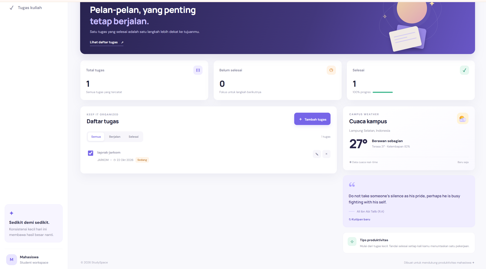

# StudySpace - Student Dashboard

**Nama:** Tarisa Menova  
**NIM:** 124140039  
**Mata Kuliah:** Pemrograman Web  
**Pertemuan:** 2

## Deskripsi

StudySpace adalah dashboard sederhana yang saya buat untuk membantu mahasiswa mengatur tugas kuliah. Website ini memiliki tampilan yang sederhana dan beberapa fitur untuk mencatat serta memantau tugas.

## Fitur

- Menambah tugas kuliah.
- Mengedit tugas yang sudah dibuat.
- Menghapus tugas.
- Menandai tugas sebagai selesai.
- Melihat jumlah tugas dan status penyelesaiannya.
- Menyimpan tugas menggunakan localStorage agar data tetap ada setelah halaman di-refresh.
- Menampilkan informasi cuaca dan kutipan melalui API.

## Teknologi

- HTML
- CSS
- JavaScript

## Konsep JavaScript yang Digunakan

- `let` dan `const` untuk variabel.
- Arrow function untuk menulis fungsi.
- Template literals untuk menggabungkan teks dan data.
- Class untuk mengatur struktur kode.
- `async/await` untuk mengambil data dari API.
- Spread syntax dan destructuring untuk mengolah data.

## Cara Menjalankan

1. Buka folder project di Visual Studio Code.
2. Buka file `index.html`.
3. Klik kanan file tersebut, lalu pilih **Open with Live Server**.
4. Website akan terbuka di browser.

## Screenshot

## File Project

- `index.html` — struktur halaman website.
- `style.css` — pengaturan tampilan.
- `app.js` — fungsi dan interaksi dashboard.
- `README.md` — dokumentasi project.
- `screenshot-dashboard.png` — screenshot website.

